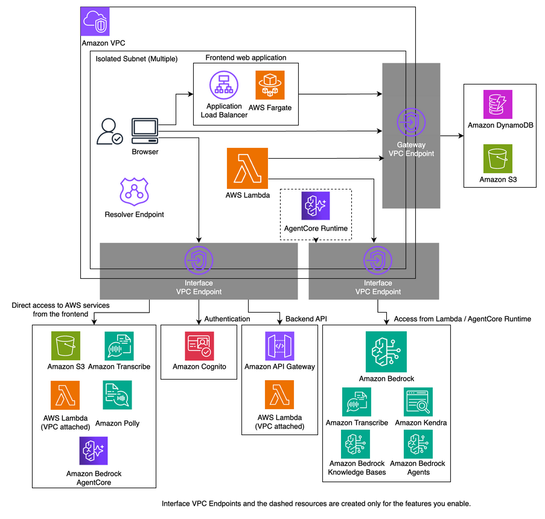

# Closed Network Mode

By setting the `closedNetworkMode` option to true, you can enable communication from clients to GenU through a closed network.
Additionally, communication between AWS Lambda, which is GenU's main computing resource, and other AWS services (such as Amazon DynamoDB, Amazon S3, and Amazon Bedrock) is completed within the VPC. The architectural changes are as follows:

- Amazon CloudFront is not used; web static files are served by Application Load Balancer and ECS Fargate.
- Amazon Cognito is accessed through Amazon API Gateway.
- Communication from Lambda functions to other services is performed via VPC Endpoints.

Options related to closed network mode have the `closedNetwork` prefix. The following is a list of options:

| Parameter                                | Description                                                                                                                                                                                                                                                                                          |
| ---------------------------------------- | ---------------------------------------------------------------------------------------------------------------------------------------------------------------------------------------------------------------------------------------------------------------------------------------------------- |
| closedNetworkMode                        | Whether to enable closed network mode. true enables closed network mode. Default is false.                                                                                                                                                                                                           |
| closedNetworkVpcIpv4Cidr                 | IPv4 CIDR to specify when creating a new VPC. Default is 10.0.0.0/16.                                                                                                                                                                                                                                |
| closedNetworkVpcId                       | VPC ID when importing an existing VPC. If not specified, a new VPC will be created.                                                                                                                                                                                                                  |
| closedNetworkSubnetIds                   | Specify multiple Subnet IDs where GenU-related resources will be deployed. ALB, Fargate tasks, VPC Endpoints, and Resolver Endpoints will be created. If not specified, Isolated Subnets will be selected. Specify two or more Subnet IDs in an array.                                               |
| closedNetworkVpcEndpointAzs              | AZs, as an array, in which Interface VPC Endpoints are created (e.g. `['ap-northeast-1a']`). One AZ only reduces cost (at the expense of availability). Default is null (all AZs). Other resources such as the ALB are not affected. With `closedNetworkSubnetIds`, only matching Subnets are used.  |
| closedNetworkApiGatewayVpcEndpointIds    | An array of VPC endpoint IDs to additionally allow in the API Gateway resource policy. The API Gateway VPC endpoint created by GenU is always allowed. Specify this when calling API Gateway through a VPC endpoint in another VPC or account (for example, a shared endpoint in a centralized VPC). |
| closedNetworkCertificateArn              | ACM ARN to specify when assigning a domain to GenU. ACM must be manually generated. If not specified, GenU will be published with the Application Load Balancer's default endpoint.                                                                                                                  |
| closedNetworkDomainName                  | GenU's domain name. Private Hosted Zone is generated by CDK, so manual creation is not required. Both `closedNetworkCertificateArn` and `closedNetworkDomainName` must be specified together or both omitted.                                                                                        |
| closedNetworkCreateTestEnvironment       | Whether to create a test environment. Created by default. Specify false if not needed. The test environment is created as an EC2 Windows instance and accessed via Fleet Manager. (Detailed procedures described later.)                                                                             |
| closedNetworkTestEnvironmentInstanceType | Instance type of the Windows test instance. Default is `t3.large` (`r6i.large` before v5.6).                                                                                                                                                                                                         |
| closedNetworkAdditionalVpcEndpoints      | Interface VPC Endpoints to create even when no enabled feature needs them, by the names in `closed-vpc.ts` (e.g. `['Kendra']`). Use it when other workloads in an imported VPC (`closedNetworkVpcId`) use these endpoints. Default is `[]`.                                                          |
| closedNetworkCreateResolverEndpoint      | Whether to generate Route53 Resolver Endpoint. Default is true.                                                                                                                                                                                                                                      |

## Architecture



## Current Limitations

- Deployment must be performed in an environment with internet connectivity. Also, internet connectivity is required when accessing the operation verification environment from the management console.
- Deployment requires the same environment as normal mode deployment. Specifically, AWS IAM user configuration, Node.js, and Docker are needed.
- The region where GenU is deployed and the model region must be the same. Currently, it's not possible to deploy GenU in ap-northeast-1 and use models from us-east-1.
- When enabling AgentCore (`agentBuilderEnabled` / `createGenericAgentCoreRuntime`), `agentCoreRegion` must also be the same region. In closed network mode, the AgentCore Runtime shares the closed VPC, so it cannot be deployed to a different region (if not specified, it automatically defaults to the same value as `region`). Research Agent (`researchAgentEnabled`) cannot be enabled in closed network mode because its runtime needs internet access.
- Since various resources are created, when importing an existing VPC, it's recommended to use as clean an environment as possible.
- SAML integration is not available.
- Voice Chat use case is currently not available.

## AgentCore in Closed Network Mode

When `closedNetworkMode: true` and either `agentBuilderEnabled` or `createGenericAgentCoreRuntime` is enabled, the AgentCore Runtime is automatically deployed with a PRIVATE network configuration (`isAgentCoreNetworkPrivate=true`), sharing the closed VPC and subnets from the ClosedNetworkStack. You do not need to separately specify `agentCoreVpcId` / `agentCoreSubnetIds`.

The following VPC Endpoints are automatically created in the closed VPC, so all communication from the AgentCore Runtime and browser InvokeAgentRuntime calls are completed within the VPC:

- `bedrock-agentcore` (Runtime data plane / control plane)
- `bedrock-agentcore.gateway` (AgentCore Gateway calls from MCP servers in the runtime; created with `agentBuilderEnabled` or `agentCoreGatewayArns`)
- `bedrock-runtime` (Foundation Model invocation)
- `ecr` / `ecr-docker` (Runtime image pull)
- `logs` (CloudWatch Logs)
- `s3` (Gateway Endpoint for FileBucket and data source access)

The AgentCore Runtime is placed in the closed VPC subnets. AgentCore Runtime VPC mode supports only some Availability Zones in a Region (for example, `use1-az1`, `use1-az2` and `use1-az4` in us-east-1). If the runtime fails to be created, specify subnets in supported AZs with `closedNetworkSubnetIds` or use an imported VPC. See [Configure Amazon Bedrock AgentCore Runtime for VPC](https://docs.aws.amazon.com/bedrock-agentcore/latest/devguide/agentcore-vpc.html).

## Feature Support in Closed Network Mode

Features that do not work in closed network mode are reported as warnings by `cdk synth` / `cdk deploy` (IDs starting with `genu:closedNetwork:`). Use cases marked "hidden" are hidden in the UI automatically.

| Feature                                                                                                          | Support       | Notes                                                                                                                                                                            |
| ---------------------------------------------------------------------------------------------------------------- | ------------- | -------------------------------------------------------------------------------------------------------------------------------------------------------------------------------- |
| Chat, Text Generation, Summarization, Writing, Translation, Diagram Generation, Video Analysis, Use Case Builder | ✅            |                                                                                                                                                                                  |
| Speech Recognition, Meeting Minutes                                                                              | ✅            |                                                                                                                                                                                  |
| RAG (Knowledge Base), RAG (Kendra)                                                                               | ✅            |                                                                                                                                                                                  |
| Agent (Bedrock Agents), Flows                                                                                    | ✅            |                                                                                                                                                                                  |
| Image Generation, Video Generation                                                                               | △             | Only models in `region` can be used. Models in other regions are not shown, and the use case is hidden when none remain.                                                         |
| AgentCore (Agent Builder, generic runtime)                                                                       | △             | Runs inside the closed VPC. Tools that need the internet (web search, URL fetch, MCP servers that call external APIs or install packages from npm/PyPI at run time) do not work. |
| MCP Chat                                                                                                         | △             | MCP servers that need the internet do not work.                                                                                                                                  |
| Voice Chat                                                                                                       | ❌ (hidden)   |                                                                                                                                                                                  |
| Web Content Extraction                                                                                           | △             | Only pages reachable from the closed VPC (for example, intranet pages). Internet pages cannot be fetched.                                                                        |
| Search Agent (`searchAgentEnabled`)                                                                              | ❌            | Calls an external search API.                                                                                                                                                    |
| Research Agent (`researchAgentEnabled`)                                                                          | ❌ (rejected) | Its runtime needs internet access, so `cdk synth` fails when it is enabled together with `closedNetworkMode`.                                                                    |
| SAML authentication                                                                                              | ❌            |                                                                                                                                                                                  |
| `allowedIpV4AddressRanges` / `allowedIpV6AddressRanges` / `allowedCountryCodes` / `hostName` / `domainName`      | ❌ (ignored)  | CloudFront and its WAF are not created. Use `closedNetworkDomainName` for a custom domain.                                                                                       |

## VPC Endpoints Created

Interface VPC Endpoints are billed per endpoint and per AZ, so only the ones the enabled features need are created. When you turn off a feature and deploy again, its endpoint is deleted.

> [!WARNING]
> When you update an existing closed network deployment, the endpoints of features that are off are deleted. If you imported a VPC with `closedNetworkVpcId` and other workloads in it use those endpoints (their private DNS names), list them in `closedNetworkAdditionalVpcEndpoints` before deploying.

| VPC Endpoint                                                                                                                                                  | Created when                                                                                                |
| ------------------------------------------------------------------------------------------------------------------------------------------------------------- | ----------------------------------------------------------------------------------------------------------- |
| `execute-api`, `lambda`, `cognito-idp`, `cognito-identity`, `s3` (Interface), `bedrock-runtime`, `bedrock-agent-runtime`, `ecr.api`, `ecr.dkr`, `logs`, `sts` | Always                                                                                                      |
| `s3`, `dynamodb` (Gateway, free of charge)                                                                                                                    | Always                                                                                                      |
| `transcribe`                                                                                                                                                  | Speech Recognition or Meeting Minutes is not hidden                                                         |
| `transcribestreaming`                                                                                                                                         | Speech Recognition, Meeting Minutes or Translation is not hidden                                            |
| `polly`                                                                                                                                                       | Translation is not hidden                                                                                   |
| `bedrock-agentcore`                                                                                                                                           | `agentBuilderEnabled`, `createGenericAgentCoreRuntime` or `agentCoreExternalRuntimes`                       |
| `bedrock-agentcore.gateway`                                                                                                                                   | `agentBuilderEnabled` or `agentCoreGatewayArns` (MCP servers in the runtime that call an AgentCore Gateway) |
| `bedrock-agent`                                                                                                                                               | `agentEnabled`, `searchAgentEnabled` or `agents`                                                            |
| `kendra`                                                                                                                                                      | `ragEnabled`                                                                                                |
| `ssm`, `ssmmessages`, `ec2messages`                                                                                                                           | `closedNetworkCreateTestEnvironment`                                                                        |

## Fixed Cost Estimate

Monthly fixed cost of the closed network resources (730 hours, On-Demand prices from the AWS Price List API as of 2026-11-10). Usage-based charges (Amazon Bedrock, Lambda, VPC endpoint data processing at $0.01/GB, ALB LCUs, etc.) are not included. Check the latest prices with the [AWS Pricing Calculator](https://calculator.aws/).

| Resource                                                             | ap-northeast-1 | us-east-1 |
| -------------------------------------------------------------------- | -------------- | --------- |
| Interface VPC Endpoint (per endpoint, per AZ)                        | $10.22         | $7.30     |
| Route 53 Resolver inbound endpoint (2 ENIs)                          | $182.50        | $182.50   |
| Application Load Balancer (hourly charge)                            | $17.74         | $16.43    |
| Fargate task for the web app (0.25 vCPU / 0.5 GB × 1)                | $11.25         | $9.01     |
| Windows test instance `r6i.large` (default before v5.6) + 100 GB gp3 | $187.72        | $167.14   |
| Windows test instance `t3.large` (default) + 100 GB gp3              | $109.17        | $88.88    |

Examples in ap-northeast-1 (new VPC with 2 AZs):

| Configuration                                                                                                                                                                                          | Interface VPC Endpoints                   | Monthly fixed cost |
| ------------------------------------------------------------------------------------------------------------------------------------------------------------------------------------------------------ | ----------------------------------------- | ------------------ |
| Defaults (test environment and Resolver endpoint on, no RAG / Agent)                                                                                                                                   | (14 + 3 for the test environment) × 2 AZs | about $668         |
| Defaults + Agent Builder                                                                                                                                                                               | (16 + 3) × 2 AZs                          | about $709         |
| Minimum: `closedNetworkCreateTestEnvironment: false`, `closedNetworkCreateResolverEndpoint: false`, `closedNetworkVpcEndpointAzs` with 1 AZ, Speech Recognition / Meeting Minutes / Translation hidden | 11 × 1 AZ                                 | about $141         |

The largest items are the test instance and the Resolver endpoint. When clients connect from your own network through an existing DNS setup, turn both off. Specifying a single AZ with `closedNetworkVpcEndpointAzs` halves the endpoint cost but lowers availability.

## Example of Valid Configuration File

Here's an example of a valid parameter.ts. If you're using cdk.json, please adapt accordingly.

```typescript
const envs: Record<string, Partial<StackInput>> = {
  // Deploy with environment name 'priv' (any environment name is fine)
  priv: {
    region: 'ap-northeast-1',
    modelRegion: 'ap-northeast-1',
    modelIds: ['apac.anthropic.claude-sonnet-4-20250514-v1:0'],
    imageGenerationModelIds: ['amazon.nova-canvas-v1:0'],
    videoGenerationModelIds: ['amazon.nova-reel-v1:0'],
    // Voice Chat is not available
    speechToSpeechModelIds: [],
    // Optional settings
    ragEnabled: true,
    ragKnowledgeBaseEnabled: true,
    agentEnabled: true,
    mcpEnabled: true,
    guardrailEnabled: true,
    useCaseBuilderEnabled: true,
    // Closed network options below
    closedNetworkMode: true,
    // The following two are not needed if not setting a domain
    closedNetworkDomainName: 'genu.closed',
    closedNetworkCertificateArn:
      'arn:aws:acm:ap-northeast-1:111111111111:certificate/aaaaaaaa-bbbb-cccc-dddd-eeeeeeeeeeee',
    // When specifying existing VPC and Subnets (the following two are not needed for new creation)
    closedNetworkVpcId: 'vpc-00000000000000000',
    closedNetworkSubnetIds: [
      'subnet-11111111111111111',
      'subnet-22222222222222222',
    ],
  },
};
```

## Deployment Method

After configuring the `closedNetwork...` options, deploy using the normal procedure written in [README.md](/README.md). An additional stack called ClosedNetworkStack\<environment name> will be deployed. (For convenience, \<environment name> will be omitted hereafter.)
The URL for accessing GenU is output in the ClosedNetworkWebUrl of ClosedNetworkStack. Note that it's not the WebUrl of GenerativeAiUseCasesStack.
Also, GenU cannot be accessed until the deployment of GenerativeAiUseCasesStack is complete.

## Verification Method

This explains the verification method when closedNetworkCreateTestEnvironment is set to true and deployed. Access the Windows EC2 instance via the management console.

### Step 1. Obtain EC2 Key Pair Private Key

Obtain the private key of the Key Pair set in EC2 to connect to the Windows instance via RDP. The command to obtain the private key is displayed in the ClosedNetworkStack output starting with `WindowsRdpGetSSMKeyCommand...`.
It looks like this:

```bash
aws ssm get-parameter --name /ec2/keypair/key-aaaaaaaaaaaaaaaaa --region ap-northeast-1 --with-decryption --query Parameter.Value --output text
```

Please copy the result of executing this command.

### Step 2. Connect to Windows Instance

1. Open the management console and go to [EC2](https://console.aws.amazon.com/ec2/home).
2. Check the instance with a name starting with ClosedNetworkStack... and click "Connect" in the upper right.
3. Select the RDP client tab, choose Connect using Fleet manager, and click Fleet Manager Remote Desktop.
4. Select Key pair for Authentication type, select Paste key pair content for Key pair content, and paste the private key obtained in step 1.
5. Click Connect.

### Step 3. Access GenU

Open the Edge browser within Windows, enter the URL displayed in the ClosedNetworkWebUrl output of ClosedNetworkStack to access GenU.
SignUp is required on first access.

### About the Verification Instance

The verification instance does not automatically stop, so please manually stop the target instance in EC2 after verification is complete.
Also, if the verification environment itself is not needed, you can delete it by setting closedNetworkCreateTestEnvironment to false and redeploying.

The default instance type changed from `r6i.large` to `t3.large` in v5.6. When you update an existing environment, the test instance is stopped and started again with the new type. To keep the previous type, set `closedNetworkTestEnvironmentInstanceType: 'r6i.large'`.

### Connecting from Your Own PC (VPN)

The test instance is meant for a quick check right after deployment. For checks by several people, or for production use, connect clients to the closed VPC through a network and set `closedNetworkCreateTestEnvironment` to false.

- **Existing on-premises network**: connect through AWS Site-to-Site VPN or AWS Direct Connect, and configure DNS as described in [DNS Server Configuration for On-Premises Connection](#dns-server-configuration-for-on-premises-connection).
- **Individual PCs**: [AWS Client VPN](https://docs.aws.amazon.com/vpn/latest/clientvpn-admin/what-is.html) lets each user open GenU in their own browser. Set the DNS server of the Client VPN endpoint to the VPC DNS (the VPC CIDR base + 2, for example `10.0.0.2`) so that the private DNS names of the VPC endpoints resolve. In ap-northeast-1 it costs $0.15 per subnet association hour (about $110/month for one subnet) plus $0.05 per connection hour (as of 2026-11-10). Client VPN needs a server certificate in ACM and mutual or SAML authentication; GenU does not create it.

AWS Verified Access is not suitable: the browser calls API Gateway, Cognito, S3, Lambda and other AWS service endpoints directly, and they cannot be placed behind Verified Access.

## Setting a Custom Domain for Closed Network GenU

### Obtaining a Certificate

Issue a certificate for the domain you want to set and import it into [AWS Certificate Manager](https://console.aws.amazon.com/acm/home).
Specify the ARN of the created Certificate in closedNetworkCertificateArn and specify the domain in closedNetworkDomainName.

The following procedure is for issuing a self-signed certificate **for verification purposes**, but please do not use this for production. **The browser will display warnings when accessing.**
Use the `openssl` command.

```bash
# Generate a key.
openssl genrsa 2048 > ssl.key

# Specify the domain you will use for Common Name
openssl req -new -key ssl.key > ssl.csr

# Issue valid for 10 years
openssl x509 -days 3650 -req -signkey ssl.key < ssl.csr > ssl.crt
```

Paste the contents of ssl.crt in Certificate body and the contents of ssl.key in Certificate private key, then click the Import certificate button.

## DNS Server Configuration for On-Premises Connection

Here we make two assumptions:

- The route from on-premises to AWS is already established. (This means that by specifying the IP address of the VPC created or imported by ClosedNetworkStack, you can reach the resources beyond it.)
- Route53 Resolver Endpoint has been created. (Resolver Endpoint is created by deploying with closedNetworkCreateResolverEndpoint set to true. This parameter is true by default.)

The endpoints that require name resolution from clients are as follows. Parts enclosed in `<>` need to be replaced with actual values.

| Service Name                | Role                        | Endpoint                                                     | How to Check Endpoint                                                                         |
| --------------------------- | --------------------------- | ------------------------------------------------------------ | --------------------------------------------------------------------------------------------- |
| Application Load Balancer   | Web static file server      | Custom domain or internal-\<aaa>.\<region>.elb.amazonaws.com | Check with ClosedNetworkWebUrl output of ClosedNetworkStack                                   |
| API Gateway                 | Main API                    | \<xxx>.execute-api.\<region>.amazonaws.com                   | Check with ApiEndpoint output of **GenerativeAiUseCasesStack**                                |
| API Gateway                 | Cognito User Pool proxy     | \<yyy>.execute-api.\<region>.amazonaws.com                   | Check with CognitoPrivateProxyCognitoUserPoolProxyApiEndpoint... output of ClosedNetworkStack |
| API Gateway                 | Cognito Identity Pool proxy | \<zzz>.execute-api.\<region>.amazonaws.com                   | Check with CognitoPrivateProxyCognitoIdPoolProxyApiEndpoint... output of ClosedNetworkStack   |
| Amazon S3                   | Signed URLs                 | s3.\<region>.amazonaws.com                                   | Endpoint is fixed                                                                             |
| AWS Lambda                  | Streaming output            | lambda.\<region>.amazonaws.com                               | Endpoint is fixed                                                                             |
| Amazon Transcribe           | Speech-to-text              | transcribe.\<region>.amazonaws.com                           | Endpoint is fixed                                                                             |
| Amazon Transcribe Streaming | Real-time speech-to-text    | transcribestreaming.\<region>.amazonaws.com                  | Endpoint is fixed                                                                             |
| Amazon Polly                | Text-to-speech              | polly.\<region>.amazonaws.com                                | Endpoint is fixed                                                                             |
| Bedrock AgentCore Runtime   | AgentCore Runtime execution | bedrock-agentcore.\<region>.amazonaws.com                    | Endpoint is fixed                                                                             |

Please modify your DNS server configuration to specify the IP address of the Resolver Endpoint as the resolver (forwarder) for all endpoints in the table above.
The IP address of the Resolver Endpoint can be confirmed by opening [Route53](https://console.aws.amazon.com/route53resolver), selecting Inbound endpoints, and clicking on the created endpoint.
Note that except for "when setting a custom domain for Application Load Balancer," all endpoints are amazonaws.com domains. Therefore, the most simplified configuration is to specify the IP address of the Resolver Endpoint as the resolver for amazonaws.com. However, this configuration has a wide scope and large side effects, so it's strongly recommended to configure each endpoint's FQDN individually.

For verification purposes, you can also set the Resolver Endpoint IP as the DNS server on your local machine. However, due to concerns about side effects in this case as well, it's strongly recommended to revert the settings after operation verification.

### When Configuring /etc/hosts for Operation Verification

When configuring the local machine's /etc/hosts, you need the IP addresses of each endpoint rather than the Resolver Endpoint.
However, since these IP addresses may change and you can only specify a single IP address without redundancy, please use this only for operation verification.
The following summarizes the endpoints that need configuration and how to check their IP addresses.

| Service Name                | Role                        | Endpoint                                                     | How to Check IP Address |
| --------------------------- | --------------------------- | ------------------------------------------------------------ | ----------------------- |
| Application Load Balancer   | Web static file server      | Custom domain or internal-\<aaa>.\<region>.elb.amazonaws.com | Method 1                |
| API Gateway                 | Main API                    | \<xxx>.execute-api.\<region>.amazonaws.com                   | Method 2                |
| API Gateway                 | Cognito User Pool proxy     | \<yyy>.execute-api.\<region>.amazonaws.com                   | Method 2                |
| API Gateway                 | Cognito Identity Pool proxy | \<zzz>.execute-api.\<region>.amazonaws.com                   | Method 2                |
| Amazon S3                   | Signed URLs                 | \<S3 bucket name>.s3.\<region>.amazonaws.com                 | Method 2                |
| AWS Lambda                  | Streaming output            | lambda.\<region>.amazonaws.com                               | Method 2                |
| Amazon Transcribe           | Speech-to-text              | transcribe.\<region>.amazonaws.com                           | Method 2                |
| Amazon Transcribe Streaming | Real-time speech-to-text    | transcribestreaming.\<region>.amazonaws.com                  | Method 2                |
| Amazon Polly                | Text-to-speech              | polly.\<region>.amazonaws.com                                | Method 2                |
| Bedrock AgentCore Runtime   | AgentCore Runtime execution | bedrock-agentcore.\<region>.amazonaws.com                    | Method 2                |

- Method 1: Open Network Interfaces in [EC2](https://console.aws.amazon.com/ec2/home) and search for "elb". The target ENI is the one with Security group names starting with ClosedNetworkStack.... Click the Network interface ID to see the Private IPv4 address. Since there are multiple, select one of them.
- Method 2: Open Endpoints in [VPC](https://console.aws.amazon.com/vpcconsole/home) and look for the corresponding service name. The service name is the reverse of the endpoint. (However, for API Gateway, the ID is omitted.) Click the VPC endpoint ID to see the deployed Subnets and IP addresses at the bottom of the page. Since there are multiple, select one of them.
