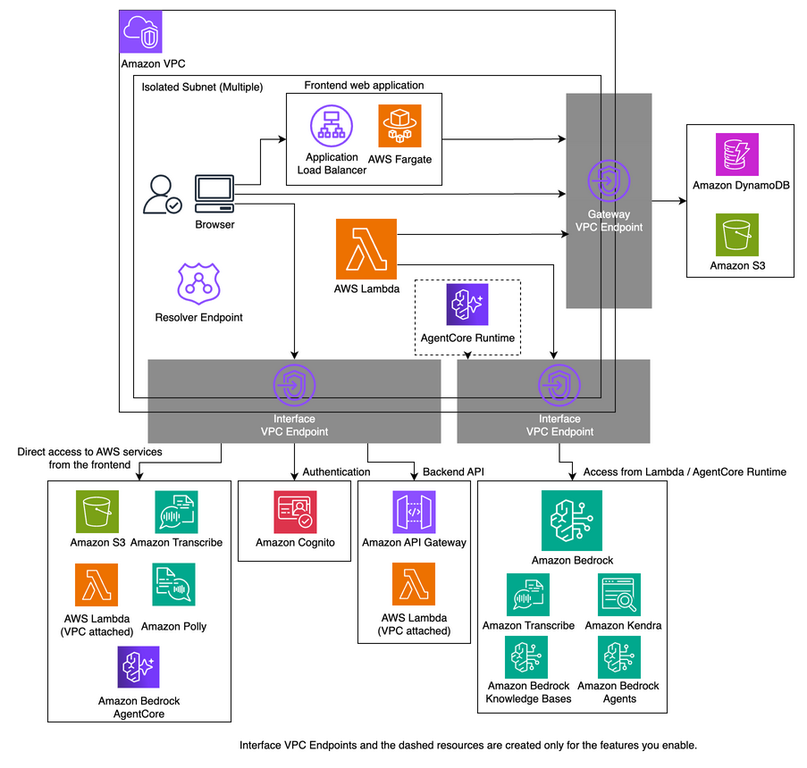

# 閉域モード

`closedNetworkMode` というオプションを true にすることで、クライアントから GenU への通信を閉域ネットワークで行うことができます。
また、GenU のメインのコンピューティングリソースである AWS Lambda と他の AWS サービス (Amazon DynamoDB や Amazon S3、Amazon Bedrock など) 間の通信も VPC 内で完結します。アーキテクチャ上の変更点は以下です。

- Amazon CloudFront は利用せず、Web の静的ファイルは Application Load Balancer と ECS Fargate でサーブします。
- Amazon Cognito へは VPC Endpoint (PrivateLink) 経由でアクセスします。
- Amazon S3 の署名付き URL へのアクセスも VPC Endpoint (Interface Endpoint) 経由で行います。
- Lambda 関数から他サービスへの通信は VPC Endpoint 経由で行います。

閉域モードに関するオプションは `closedNetwork` プレフィックスがついています。以下がオプション一覧です。

| パラメータ                               | 説明                                                                                                                                                                                                                                                                                                       |
| ---------------------------------------- | ---------------------------------------------------------------------------------------------------------------------------------------------------------------------------------------------------------------------------------------------------------------------------------------------------------- |
| closedNetworkMode                        | 閉域モードにするかどうか。true だと閉域モード。デフォルトは false。                                                                                                                                                                                                                                        |
| closedNetworkVpcIpv4Cidr                 | VPC を新規作成する場合に指定する IPv4 の CIDR。デフォルトでは 10.0.0.0/16。                                                                                                                                                                                                                                |
| closedNetworkVpcId                       | VPC をインポートする場合の VPC ID。こちらを指定しないと VPC は新規作成になる。                                                                                                                                                                                                                             |
| closedNetworkSubnetIds                   | GenU 関連のリソースをデプロイする Subnet の ID を複数指定。ALB、Fargate タスク、VPC Endpoint、Resolver Endpoint が作成される。こちらは指定しないと Isolated な Subnet が選択される。2 つ以上の Subnet ID を配列で指定する。                                                                                |
| closedNetworkVpcEndpointAzs              | インターフェース型 VPC エンドポイントを作成する AZ を配列で指定する（例: `['ap-northeast-1a']`）。1 つのみ指定すると費用を削減できる（可用性は下がる）。デフォルトは null で全 AZ。ALB など他のリソースには影響しない。`closedNetworkSubnetIds` と併用時は両方に一致する Subnet のみ対象。                 |
| closedNetworkApiGatewayVpcEndpointIds    | API Gateway のリソースポリシーで追加で許可する VPC エンドポイント ID の配列。GenU が作成する API Gateway 用の VPC エンドポイントは、指定の有無にかかわらず許可される。別の VPC や別のアカウントにある VPC エンドポイント（集約 VPC の共有エンドポイントなど）を経由して API Gateway を呼ぶ場合に指定する。 |
| closedNetworkCertificateArn              | GenU にドメインを付与する場合に指定する ACM の ARN。ACM は手動で生成する。指定しない場合、GenU は Application Load Balancer のデフォルトのエンドポイントで公開される。                                                                                                                                     |
| closedNetworkDomainName                  | GenU のドメイン名。Private Hosted Zone は CDK が生成するため、手動作成不要。`closedNetworkCertificateArn` と `closedNetworkDomainName` は両方指定するか、両方指定しないかのどちらかである必要あり。                                                                                                        |
| closedNetworkCreateTestEnvironment       | 検証環境を作成するかどうか。デフォルトで作成する。必要ない場合は false を指定する。検証環境は EC2 の Windows インスタンスとして作成し、Fleet Manager 経由でアクセスする。(詳細な手順は後述。)                                                                                                              |
| closedNetworkTestEnvironmentInstanceType | 検証用 Windows インスタンスのインスタンスタイプ。デフォルトは `r6i.large`。`t3.large` などにすると検証環境の費用を下げられる。                                                                                                                                                                             |
| closedNetworkAdditionalVpcEndpoints      | 有効な機能が必要としない場合でも作成する Interface VPC Endpoint を `closed-vpc.ts` の名前で指定する (例: `['Kendra']`)。インポートした VPC (`closedNetworkVpcId`) の他のワークロードがその VPC Endpoint を使っている場合に指定する。デフォルトは `[]`。                                                    |
| closedNetworkCreateResolverEndpoint      | Route53 の Resolver Endpoint を生成するかどうか。デフォルトで true。                                                                                                                                                                                                                                       |

## アーキテクチャ



## 現状の制約

- デプロイはインターネットに疎通可能な環境で行う必要があります。また、動作検証環境にはマネージメントコンソールからアクセスするため、その場合もインターネット疎通が必要になります。
- デプロイには、通常モードのデプロイと同様の環境が必要です。具体的には、AWS IAM ユーザーの設定、Node.js、Docker が必要です。
- GenU がデプロイされるリージョンとモデルのリージョンは同一である必要があります。GenU を ap-northeast-1 にデプロイし、us-east-1 のモデルを利用するといったことは現状できません。
- AgentCore (`agentBuilderEnabled` / `createGenericAgentCoreRuntime`) を有効化する場合、`agentCoreRegion` も同一リージョンである必要があります。閉域モードでは閉域 VPC を AgentCore Runtime が共有するため、別リージョンへのデプロイはできません (指定がない場合は自動的に `region` と同一になります)。Research Agent (`researchAgentEnabled`) はランタイムにインターネット接続が必要なため、閉域モードでは有効にできません。
- 様々なリソースを作成するため、既存の VPC をインポートする場合は可能な限り clean な環境を利用することを推奨します。
- SAML 連携は利用できません。
- Voice Chat のユースケースは現状利用できません。

## 閉域モードでの AgentCore

`closedNetworkMode: true` かつ `agentBuilderEnabled` または `createGenericAgentCoreRuntime` を有効化した場合、AgentCore Runtime は自動的に PRIVATE ネットワーク構成 (`isAgentCoreNetworkPrivate=true`) でデプロイされ、閉域 VPC とサブネットを ClosedNetworkStack から共有します。`agentCoreVpcId` / `agentCoreSubnetIds` を別途指定する必要はありません。

VPC Endpoint は閉域 VPC に下記が自動作成されるため、AgentCore Runtime からの通信および ブラウザからの InvokeAgentRuntime はすべて VPC 内で完結します。

- `bedrock-agentcore` (Runtime データプレーン / コントロールプレーン)
- `bedrock-agentcore.gateway` (ランタイム内の MCP サーバーからの AgentCore Gateway 呼び出し。`agentBuilderEnabled` または `agentCoreGatewayArns` のときに作成)
- `bedrock-runtime` (Foundation Model 呼び出し)
- `ecr` / `ecr-docker` (Runtime イメージの Pull)
- `logs` (CloudWatch Logs)
- `s3` (Gateway Endpoint。FileBucket やデータソースへのアクセス)

AgentCore Runtime は閉域 VPC のサブネットに配置されます。AgentCore Runtime の VPC モードは、リージョン内の一部の AZ のみに対応しています (例: us-east-1 では `use1-az1`、`use1-az2`、`use1-az4`)。ランタイムの作成に失敗する場合は、`closedNetworkSubnetIds` で対応 AZ のサブネットを指定するか、既存の VPC をインポートしてください。詳細は [Configure Amazon Bedrock AgentCore Runtime for VPC](https://docs.aws.amazon.com/bedrock-agentcore/latest/devguide/agentcore-vpc.html) を参照してください。

## 閉域モードで利用できる機能

閉域モードで動作しない設定は、`cdk synth` / `cdk deploy` 時に Warning として表示されます（ID は `genu:closedNetwork:` で始まります）。「非表示」とあるユースケースは UI から自動で非表示になります。

| 機能                                                                                                        | 対応        | 補足                                                                                                                                                                               |
| ----------------------------------------------------------------------------------------------------------- | ----------- | ---------------------------------------------------------------------------------------------------------------------------------------------------------------------------------- |
| チャット、文章生成、要約、執筆、翻訳、ダイアグラム生成、映像分析、ユースケースビルダー                      | ✅          |                                                                                                                                                                                    |
| 音声認識、議事録生成                                                                                        | ✅          |                                                                                                                                                                                    |
| RAG (Knowledge Base)、RAG (Kendra)                                                                          | ✅          |                                                                                                                                                                                    |
| Agent (Bedrock Agents)、Flows                                                                               | ✅          |                                                                                                                                                                                    |
| 画像生成、動画生成                                                                                          | △           | `region` のモデルのみ利用できます。他リージョンのモデルは表示されず、1 つも残らない場合はユースケースごと非表示になります。                                                        |
| AgentCore (エージェントビルダー、汎用ランタイム)                                                            | △           | 閉域 VPC 内で動作します。インターネットが必要なツール (Web 検索、URL 取得、外部 API を呼ぶ MCP サーバーや実行時に npm/PyPI からパッケージを取得する MCP サーバー) は動作しません。 |
| MCP チャット                                                                                                | △           | インターネットが必要な MCP サーバーは動作しません。                                                                                                                                |
| 音声チャット                                                                                                | ❌ (非表示) |                                                                                                                                                                                    |
| Web コンテンツ抽出                                                                                          | △           | 閉域 VPC から到達できるページ (社内ページなど) のみ取得できます。インターネット上のページは取得できません。                                                                        |
| 検索エージェント (`searchAgentEnabled`)                                                                     | ❌          | 外部の検索 API を呼び出します。                                                                                                                                                    |
| Research Agent (`researchAgentEnabled`)                                                                     | ❌ (エラー) | ランタイムにインターネット接続が必要なため、`closedNetworkMode` と同時に有効にすると `cdk synth` がエラーになります。                                                              |
| SAML 連携                                                                                                   | ❌          |                                                                                                                                                                                    |
| `allowedIpV4AddressRanges` / `allowedIpV6AddressRanges` / `allowedCountryCodes` / `hostName` / `domainName` | ❌ (無視)   | CloudFront と WAF を作成しないため無視されます。独自ドメインは `closedNetworkDomainName` を利用してください。                                                                      |

## 作成される VPC Endpoint

Interface 型の VPC Endpoint はエンドポイントごと・AZ ごとに課金されるため、有効にした機能に必要なものだけを作成します。機能を無効にして再デプロイすると、その VPC Endpoint は削除されます。

> [!WARNING]
> 既存の閉域環境を更新すると、無効な機能の VPC Endpoint は削除されます。`closedNetworkVpcId` でインポートした VPC の他のワークロードがそれらの VPC Endpoint (プライベート DNS 名) を使っている場合は、デプロイ前に `closedNetworkAdditionalVpcEndpoints` に指定してください。

| VPC Endpoint                                                                                                                                                  | 作成される条件                                                                                                   |
| ------------------------------------------------------------------------------------------------------------------------------------------------------------- | ---------------------------------------------------------------------------------------------------------------- |
| `execute-api`、`lambda`、`cognito-idp`、`cognito-identity`、`s3` (Interface)、`bedrock-runtime`、`bedrock-agent-runtime`、`ecr.api`、`ecr.dkr`、`logs`、`sts` | 常に作成                                                                                                         |
| `s3`、`dynamodb` (Gateway 型、無料)                                                                                                                           | 常に作成                                                                                                         |
| `transcribe`                                                                                                                                                  | 音声認識または議事録生成を非表示にしていない                                                                     |
| `transcribestreaming`                                                                                                                                         | 音声認識、議事録生成、翻訳のいずれかを非表示にしていない                                                         |
| `polly`                                                                                                                                                       | 翻訳を非表示にしていない                                                                                         |
| `bedrock-agentcore`                                                                                                                                           | `agentBuilderEnabled`、`createGenericAgentCoreRuntime`、`agentCoreExternalRuntimes` のいずれか                   |
| `bedrock-agentcore.gateway`                                                                                                                                   | `agentBuilderEnabled` または `agentCoreGatewayArns` (ランタイム内の MCP サーバーが AgentCore Gateway を呼ぶ場合) |
| `bedrock-agent`                                                                                                                                               | `agentEnabled`、`searchAgentEnabled`、`agents` のいずれか                                                        |
| `kendra`                                                                                                                                                      | `ragEnabled`                                                                                                     |
| `ssm`、`ssmmessages`、`ec2messages`                                                                                                                           | `closedNetworkCreateTestEnvironment`                                                                             |

## 固定費の目安

閉域モードで作成されるリソースの月額固定費です (730 時間、AWS Price List API のオンデマンド料金、2026-11-10 時点)。Amazon Bedrock や Lambda などの従量課金、VPC Endpoint のデータ処理料金 ($0.01/GB)、ALB の LCU は含みません。最新の料金は [AWS Pricing Calculator](https://calculator.aws/) で確認してください。

| リソース                                                | ap-northeast-1 | us-east-1 |
| ------------------------------------------------------- | -------------- | --------- |
| Interface VPC Endpoint (1 エンドポイント・1 AZ あたり)  | $10.22         | $7.30     |
| Route 53 Resolver インバウンドエンドポイント (ENI 2 つ) | $182.50        | $182.50   |
| Application Load Balancer (時間料金)                    | $17.74         | $16.43    |
| Web アプリ用 Fargate タスク (0.25 vCPU / 0.5 GB × 1)    | $11.25         | $9.01     |
| 検証用 Windows インスタンス `r6i.large` + gp3 100 GB    | $187.72        | $167.14   |
| 検証用 Windows インスタンス `t3.large` + gp3 100 GB     | $109.17        | $88.88    |

ap-northeast-1 での構成例 (VPC を新規作成、2 AZ):

| 構成                                                                                                                                                                           | Interface VPC Endpoint の数 | 月額固定費 |
| ------------------------------------------------------------------------------------------------------------------------------------------------------------------------------ | --------------------------- | ---------- |
| デフォルト (検証環境と Resolver Endpoint あり、RAG / Agent なし)                                                                                                               | (14 + 検証環境用 3) × 2 AZ  | 約 $747    |
| デフォルト + エージェントビルダー                                                                                                                                              | (16 + 3) × 2 AZ             | 約 $788    |
| 最小構成: `closedNetworkCreateTestEnvironment: false`、`closedNetworkCreateResolverEndpoint: false`、`closedNetworkVpcEndpointAzs` で 1 AZ、音声認識・議事録生成・翻訳を非表示 | 11 × 1 AZ                   | 約 $141    |

大きいのは検証用インスタンスと Resolver Endpoint です。既存の DNS 経由で自社ネットワークから接続する場合は、どちらも無効にしてください。`closedNetworkVpcEndpointAzs` で AZ を 1 つにすると VPC Endpoint の費用は半分になりますが、可用性は下がります。

## 有効な設定ファイルの例

有効な parameter.ts の例を示します。cdk.json をご利用の場合は、適宜読み替えてください。

```typescript
const envs: Record<string, Partial<StackInput>> = {
  // priv という環境名でデプロイする (任意の環境名で良い)
  priv: {
    region: 'ap-northeast-1',
    modelRegion: 'ap-northeast-1',
    modelIds: ['apac.anthropic.claude-sonnet-4-20250514-v1:0'],
    imageGenerationModelIds: ['amazon.nova-canvas-v1:0'],
    videoGenerationModelIds: ['amazon.nova-reel-v1:0'],
    // Voice Chat は利用不可
    speechToSpeechModelIds: [],
    // 任意のオプション
    ragEnabled: true,
    ragKnowledgeBaseEnabled: true,
    agentEnabled: true,
    mcpEnabled: true,
    guardrailEnabled: true,
    useCaseBuilderEnabled: true,
    // 以下は閉域のオプション
    closedNetworkMode: true,
    // ドメインを設定しない場合は以下の 2 つは不要
    closedNetworkDomainName: 'genu.closed',
    closedNetworkCertificateArn:
      'arn:aws:acm:ap-northeast-1:111111111111:certificate/aaaaaaaa-bbbb-cccc-dddd-eeeeeeeeeeee',
    // 既存の VPC を Subnet を指定する場合 (新規作成する場合は以下の 2 つは不要)
    closedNetworkVpcId: 'vpc-00000000000000000',
    closedNetworkSubnetIds: [
      'subnet-11111111111111111',
      'subnet-22222222222222222',
    ],
  },
};
```

## デプロイ方法

`closedNetwork...` オプションを設定した上で [README.md](/README_ja.md) に記載されている通常の手順でデプロイしてください。ClosedNetworkStack\<環境名> というスタックが追加でデプロイされます。(便宜上、これ以降は \<環境名> を省略します。)
GenU にアクセスするための URL は ClosedNetworkStack の ClosedNetworkWebUrl に出力されます。GenerativeAiUseCasesStack の WebUrl ではないことに注意してください。
また、GenerativeAiUseCasesStack のデプロイが完了するまでは GenU にアクセスできません。

## 検証方法

closedNetworkCreateTestEnvironment を true にしてデプロイした場合の検証方法について説明いたします。マネージメントコンソール経由で Windows の EC2 インスタンスにアクセスします。

### 手順1. EC2 Key Pair の Private Key の取得

Windows インスタンスに RDP で接続するために EC2 に設定した Key Pair の private key を取得します。private pey を取得するためのコマンドは `WindowsRdpGetSSMKeyCommand...` で始まる ClosedNetworkStack の出力に表示されています。
以下のようなものです。

```bash
aws ssm get-parameter --name /ec2/keypair/key-aaaaaaaaaaaaaaaaa --region ap-northeast-1 --with-decryption --query Parameter.Value --output text
```

こちらのコマンドを実行した結果をコピーしてください。

### 手順2. Windows インスタンスに接続

1. マネージメントコンソールを開き、[EC2](https://console.aws.amazon.com/ec2/home) を開きます。
2. ClosedNetworkStack... から始める名前のインスタンスにチェックを入れ、右上の「Connect」をクリックします。
3. タブで RDP client を選択し、Connect using Fleet manager を選択して Fleet Manager Remote Desktop をクリックします。
4. Authentication type は Key pair を選択し、Key pair content を Paste key pair content を選択して手順 1 で取得した private key を貼り付けます。
5. Connect をクリックします。

### 手順3. GenU にアクセス

Windows 内で Edge ブラウザを開き、ClosedNetworkStack の ClosedNetworkWebUrl 出力に表示される URL を入力して GenU にアクセスします。
初回アクセス時は SignUp が必要です。

### 検証インスタンスについて

検証インスタンスは自動停止しないため、検証が完了したら EC2 を開いて対象インスタンスを手動で停止してください。
また、検証環境そのものが不要であれば、closedNetworkCreateTestEnvironment を false にしてデプロイし直すことで、削除可能です。

## 閉域 GenU に独自のドメインを設定する

### 証明書の取得

設定するドメインの証明書を発行し、[AWS Certificate Manager](https://console.aws.amazon.com/acm/home) にインポートしてください。
作成した Certificate の ARN を closedNetworkCertificateArn に指定し、ドメインを closedNetworkDomainName に指定します。

以下の手順は **検証目的のために** 自己証明書を発行する手順ですが、こちらは本番利用しないでください。**アクセス時にはブラウザが警告を表示します。**
`openssl` コマンドを利用します。

```bash
# 鍵を生成します。
openssl genrsa 2048 > ssl.key

# Common Name には利用するドメインを指定してください
openssl req -new -key ssl.key > ssl.csr

# 10 年有効で発行します
openssl x509 -days 3650 -req -signkey ssl.key < ssl.csr > ssl.crt
```

Certificate body には ssl.crt の中身、Certificate private key には ssl.key の中身を貼り付けて Import certificate ボタンをクリックしてください。

## オンプレから接続する場合の DNS サーバーの設定について

ここでは 2 つの前提を置きます。

- オンプレから AWS に接続するルートはすでに確立している。(ClosedNetworkStack で作成した or にインポートした VPC の IP アドレスを指定すれば、その先のリソースにたどり着ける状態のことです。)
- Route53 の Resolver Endpoint は作成済み。(Resolver Endpoint は closedNetworkCreateResolverEndpoint を true にしてデプロイすることで作成されます。このパラメータはデフォルトで true です。)

クライアントから名前解決が必要なエンドポイントは以下の通りです。`<>` で囲まれた箇所は実際の値に置き換えが必要です。

| サービス名                  | 役割                       | エンドポイント                                              | エンドポイントの確認方法                                  |
| --------------------------- | -------------------------- | ----------------------------------------------------------- | --------------------------------------------------------- |
| Application Load Balancer   | Web 静的ファイルのサーバー | 独自ドメイン or internal-\<aaa>.\<region>.elb.amazonaws.com | ClosedNetworkStack の出力の ClosedNetworkWebUrl で確認    |
| API Gateway                 | メインの API               | \<xxx>.execute-api.\<region>.amazonaws.com                  | **GenerativeAiUseCasesStack** の出力の ApiEndpoint で確認 |
| Cognito User Pool           | 認証                       | cognito-idp.\<region>.amazonaws.com                         | エンドポイントは固定                                      |
| Cognito Identity Pool       | 一時認証情報の取得         | cognito-identity.\<region>.amazonaws.com                    | エンドポイントは固定                                      |
| Amazon S3                   | 署名付き URL               | s3.\<region>.amazonaws.com                                  | エンドポイントは固定                                      |
| AWS Lambda                  | ストリーミング出力         | lambda.\<region>.amazonaws.com                              | エンドポイントは固定                                      |
| Amazon Transcribe           | 文字起こし                 | transcribe.\<region>.amazonaws.com                          | エンドポイントは固定                                      |
| Amazon Transcribe Streaming | リアルタイム文字起こし     | transcribestreaming.\<region>.amazonaws.com                 | エンドポイントは固定                                      |
| Amazon Polly                | 文字の読み上げ             | polly.\<region>.amazonaws.com                               | エンドポイントは固定                                      |
| Bedrock AgentCore Runtime   | AgentCore Runtime の実行   | bedrock-agentcore.\<region>.amazonaws.com                   | エンドポイントは固定                                      |

上の表のすべてのエンドポイントのリゾルバー (フォワーダー) として Resolver Endpoint の IP アドレスを指定するように DNS サーバーの設定を変更してください。
Resolver Endpoint の IP アドレスは、[Route53](https://console.aws.amazon.com/route53resolver) を開き、Inbound endpoints を選択して、作成したエンドポイントをクリックすることで確認できます。
なお、「Application Load Balancer に独自のドメインを設定している場合」を除き、すべてのエンドポイントは amazonaws.com ドメインです。そのため、amazonaws.com のリゾルバーとして Resolver Endpoint の IP アドレスを指定する方法が最も簡略的な設定です。ただし、この設定は対象範囲が広く、副作用が大きいため、各エンドポイントの FQDN で設定をいれることを強く推奨いたします。

動作確認のために、手元の端末に DNS サーバーとして Resolver Endpoint の IP を設定することもできます。ただし、この場合も副作用の懸念から、動作検証後には設定を戻すことを強く推奨いたします。

### /etc/hosts を設定して動作検証する場合

端末の /etc/hosts に設定する場合は Resolver Endpoint ではなくそれぞれのエンドポイントの IP アドレスが必要になります。
ただし、それらの IP アドレスは変更される可能性があり、かつ単一の IP アドレスしか指定できず冗長性もないため、あくまで動作検証にのみ利用してください。
設定が必要なエンドポイントと IP アドレスの確認方法を以下にまとめます。

| サービス名                  | 役割                       | エンドポイント                                              | IP アドレスの確認方法 |
| --------------------------- | -------------------------- | ----------------------------------------------------------- | --------------------- |
| Application Load Balancer   | Web 静的ファイルのサーバー | 独自ドメイン or internal-\<aaa>.\<region>.elb.amazonaws.com | 方法1                 |
| API Gateway                 | メインの API               | \<xxx>.execute-api.\<region>.amazonaws.com                  | 方法2                 |
| Cognito User Pool           | 認証                       | cognito-idp.\<region>.amazonaws.com                         | 方法2                 |
| Cognito Identity Pool       | 一時認証情報の取得         | cognito-identity.\<region>.amazonaws.com                    | 方法2                 |
| Amazon S3                   | 署名付き URL               | \<S3 バケット名>.s3.\<region>.amazonaws.com                 | 方法2                 |
| AWS Lambda                  | ストリーミング出力         | lambda.\<region>.amazonaws.com                              | 方法2                 |
| Amazon Transcribe           | 文字起こし                 | transcribe.\<region>.amazonaws.com                          | 方法2                 |
| Amazon Transcribe Streaming | リアルタイム文字起こし     | transcribestreaming.\<region>.amazonaws.com                 | 方法2                 |
| Amazon Polly                | 文字の読み上げ             | polly.\<region>.amazonaws.com                               | 方法2                 |
| Bedrock AgentCore Runtime   | AgentCore Runtime の実行   | bedrock-agentcore.\<region>.amazonaws.com                   | 方法2                 |

- 方法1: [EC2](https://console.aws.amazon.com/ec2/home) の Network Interfaces を開き、「elb」と検索してください。Security group names が ClosedNetworkStack... となっているものが対象の ENI です。Network interface ID をクリックすると Private IPv4 address が確認できます。複数あるため、そのうち 1 つを選択してください。
- 方法2: [VPC](https://console.aws.amazon.com/vpcconsole/home) の Endpoints を開き、該当するサービス名を探してください。サービス名はエンドポイントを反転させたものです。(ただし API Gateway は ID を省略したものです。) VPC endpoint ID をクリックすると、ページ下部にデプロイされた Subnet と IP アドレスが表示されています。複数あるため、そのうち 1 つを選択してください。
